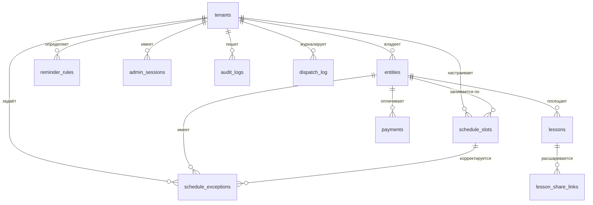
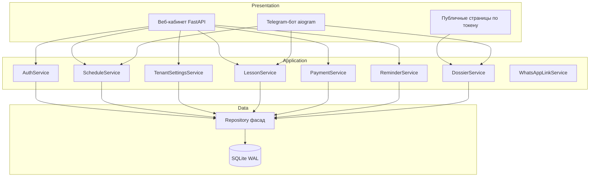
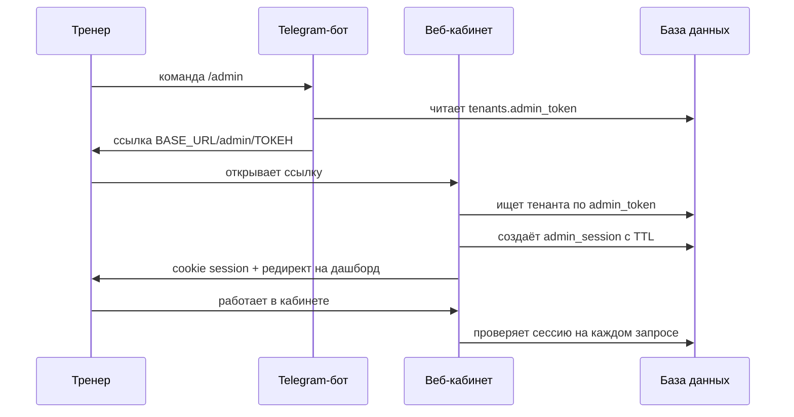

# PlanZy: архитектура «сайт — главный, бот — помощник»

Документ фиксирует целевую архитектуру после смены парадигмы.
Раньше центром был Telegram-бот, а сайт — витриной. Теперь наоборот:
**веб-кабинет тренера — основной интерфейс работы**, а бот выполняет
вспомогательные задачи (быстрая запись итогов, напоминания, выдача ссылок).

---

## 1. Принципы

1. **Единый источник правды — база данных.** И сайт, и бот пишут в одни и те же
   таблицы через одни и те же сервисы. Никаких «двух правд».
2. **Настройки живут в БД, а не в `.env`.** Цена занятия, валюта, порядок оплаты,
   часовой пояс, правила напоминаний — персональны для каждого тренера.
   `.env` остаётся только для инфраструктуры (токены, порты, URL).
3. **Расписание — полноценная сущность.** Не два поля в карточке ученика, а
   таблица слотов плюс таблица разовых исключений (перенос/отмена/доп. занятие).
4. **Бот не дублирует логику.** Он вызывает те же сервисы, что и веб-роуты.
5. **Публичные страницы — только по токену.** Никаких списков без авторизации.

---

## 2. Схема базы данных

### 2.1. Существующие таблицы (переиспользуем)

| Таблица | Назначение | Изменения |
|---|---|---|
| `tenants` | Тренер | Добавляются поля настроек и `admin_token` |
| `entities` | Ученик или группа | `schedule_days`/`schedule_time` объявляются устаревшими |
| `lessons` | Проведённый урок | Без изменений |
| `payments` | Платёж за абонемент | Без изменений |

### 2.2. Расширение `tenants`

| Поле | Тип | Назначение |
|---|---|---|
| `admin_token` | `String(64)`, unique | Секрет для входа в кабинет по ссылке |
| `timezone` | `String(64)` | Часовой пояс тренера, по умолчанию `Asia/Jerusalem` |
| `lesson_price` | `Float` | Стоимость одного занятия |
| `currency` | `String(8)` | Валюта, по умолчанию `ILS` |
| `payment_instructions` | `Text`, nullable | Порядок оплаты: реквизиты, правила, скидки |
| `low_balance_threshold` | `Integer` | Порог «пора напомнить об оплате», по умолчанию 1 |

### 2.3. Новая таблица `schedule_slots`

Регулярное расписание: одна запись — одно повторяющееся занятие.

| Поле | Тип | Назначение |
|---|---|---|
| `id` | `Integer` PK | |
| `tenant_id` | FK → `tenants.id` CASCADE | Изоляция данных |
| `entity_id` | FK → `entities.id` CASCADE | Кто занимается |
| `weekday` | `String(3)` | `mon`..`sun` |
| `start_time` | `String(5)` | `ЧЧ:ММ` |
| `duration_min` | `Integer` | Длительность в минутах, по умолчанию 60 |
| `location` | `String(255)`, nullable | Кабинет, адрес или ссылка на созвон |
| `is_active` | `Boolean` | Мягкое отключение слота |
| `created_at` | `DateTime` | |

Ограничения и индексы:
- `CheckConstraint` на `weekday IN ('mon','tue','wed','thu','fri','sat','sun')`
- `Index('ix_schedule_slots_tenant_weekday', 'tenant_id', 'weekday')`
- `Index('ix_schedule_slots_entity', 'entity_id')`

### 2.4. Новая таблица `schedule_exceptions`

Разовые отклонения от регулярного расписания.

| Поле | Тип | Назначение |
|---|---|---|
| `id` | `Integer` PK | |
| `tenant_id` | FK → `tenants.id` CASCADE | |
| `entity_id` | FK → `entities.id` CASCADE | |
| `slot_id` | FK → `schedule_slots.id` SET NULL, nullable | Какой слот затрагивается |
| `exception_date` | `Date` | Дата, к которой относится исключение |
| `kind` | `String(16)` | `moved` / `cancelled` / `extra` |
| `new_time` | `String(5)`, nullable | Новое время для `moved` |
| `note` | `Text`, nullable | Причина или комментарий |
| `created_at` | `DateTime` | |

Ограничения и индексы:
- `CheckConstraint` на `kind IN ('moved','cancelled','extra')`
- `Index('ix_schedule_exceptions_tenant_date', 'tenant_id', 'exception_date')`

### 2.5. Новая таблица `reminder_rules`

Правила, когда и какие напоминания отправлять.

| Поле | Тип | Назначение |
|---|---|---|
| `id` | `Integer` PK | |
| `tenant_id` | FK → `tenants.id` CASCADE | |
| `kind` | `String(24)` | `day_before` / `morning_of` / `low_balance` |
| `time_of_day` | `String(5)`, nullable | Время отправки `ЧЧ:ММ` |
| `offset_minutes` | `Integer`, nullable | Сдвиг от начала занятия (для `day_before`) |
| `is_enabled` | `Boolean` | Включено ли правило |
| `channel` | `String(16)` | `telegram` (пока единственный) |
| `created_at` | `DateTime` | |

Ограничения и индексы:
- `CheckConstraint` на `kind IN ('day_before','morning_of','low_balance')`
- `UniqueConstraint('tenant_id', 'kind')` — одно правило каждого типа на тренера

### 2.6. Новая таблица `lesson_share_links`

Одноразовые/временные ссылки на конкретный урок для родителя.

| Поле | Тип | Назначение |
|---|---|---|
| `id` | `Integer` PK | |
| `tenant_id` | FK → `tenants.id` CASCADE | |
| `lesson_id` | FK → `lessons.id` CASCADE | |
| `token` | `String(64)`, unique | Публичный токен ссылки |
| `expires_at` | `DateTime`, nullable | Срок жизни, `NULL` — бессрочно |
| `is_revoked` | `Boolean` | Отозвана ли ссылка вручную |
| `created_at` | `DateTime` | |

Индексы:
- `UniqueConstraint('token')`
- `Index('ix_lesson_share_links_lesson', 'lesson_id')`

### 2.7. Новая таблица `admin_sessions`

Сессии входа в кабинет.

| Поле | Тип | Назначение |
|---|---|---|
| `id` | `Integer` PK | |
| `tenant_id` | FK → `tenants.id` CASCADE | |
| `token` | `String(64)`, unique | Значение cookie |
| `expires_at` | `DateTime` | Срок жизни сессии |
| `created_at` | `DateTime` | |

### 2.8. Новая таблица `audit_logs`

Журнал изменений из кабинета — чтобы понимать, кто и что правил.

| Поле | Тип | Назначение |
|---|---|---|
| `id` | `Integer` PK | |
| `tenant_id` | FK → `tenants.id` CASCADE | |
| `actor` | `String(32)` | `web` / `bot` / `scheduler` |
| `action` | `String(64)` | Например, `student.update` |
| `payload` | `Text`, nullable | JSON с деталями изменения |
| `created_at` | `DateTime` | |

### 2.9. Новая таблица `dispatch_log`

Журнал отправленных напоминаний — защита от дублирования.

| Поле | Тип | Назначение |
|---|---|---|
| `id` | `Integer` PK | |
| `tenant_id` | FK → `tenants.id` CASCADE | |
| `entity_id` | FK → `entities.id` CASCADE, nullable | |
| `rule_kind` | `String(24)` | Какое правило сработало |
| `dispatch_date` | `Date` | Дата отправки |
| `sent_at` | `DateTime` | Момент отправки |

Ограничения:
- `UniqueConstraint('tenant_id', 'entity_id', 'rule_kind', 'dispatch_date')`

---

## 3. Схема связей

---

## 4. Слои приложения

---

## 5. Аутентификация кабинета

Выбран вариант «секретная ссылка-токен» без пароля.

Параметры cookie:
- `HttpOnly` — всегда
- `Secure` — только в `production`
- `SameSite=Lax`
- Срок жизни — 30 дней, продлевается при активности

---

## 6. Публичные ссылки

| Ссылка | Что показывает | Срок жизни |
|---|---|---|
| `/l/{public_token}` | Постоянная карточка ученика: расписание, последнее занятие, ДЗ, примечание, итоги | Бессрочно |
| `/lesson/{share_token}` | Отчёт за конкретное занятие: тема, ДЗ, план | Настраиваемый, можно отозвать |

Принципиально: `internal_notes` тренера **никогда** не попадают на публичные
страницы. Это проверяется тестами.

---

## 7. Роли бота после рефакторинга

| Команда | Назначение |
|---|---|
| `/admin` | Выдать секретную ссылку на веб-кабинет (кликабельную) |
| `/today` | Занятия на сегодня и на завтра с учётом исключений |
| `/student` | Список учеников; выбор кнопкой открывает досье |
| `/group` | Список групп; выбор кнопкой открывает досье |
| текст (диктовка) | Разобрать занятие, показать предпросмотр, записать после подтверждения |

Все команды публикуются в меню Telegram (`set_my_commands` при старте).
Списки — инлайн-кнопки с `callback_data`: нажатие открывает то же досье,
что и прежняя команда `/dossier <имя>` (она сохранена как текстовый
алиас, но в меню не выводится).

**Запись занятия проходит в два шага.** Диктовка разбирается методом
`LessonService.prepare` — без записи в БД, затем распознанный результат
лежит в FSM и показывается тренеру. По кнопке «✅ Да, записать»
вызывается `LessonService.apply_parse_result`. Кнопка «❌ Нет» очищает
состояние и ждёт новый текст.

Бот **не создаёт** учеников и группы: если имя не найдено, поднимается
`UnknownEntityError` и тренер получает подсказку завести карточку в
кабинете. Дата занятия всегда равна текущей дате.

Бот **не** управляет расписанием и настройками — это делает сайт.

---

## 8. План миграции данных

1. Добавить новые таблицы и поля (Alembic `upgrade`).
2. Перенести данные:
   - `entities.schedule_days` + `schedule_time` → строки в `schedule_slots`
     (один слот на каждый день недели).
   - `settings.lesson_price` и `settings.currency` → поля `tenants`.
3. Сгенерировать `admin_token` для каждого существующего тенанта.
4. Создать правила напоминаний по умолчанию для каждого тенанта:
   `morning_of` в 08:30, `low_balance` при пороге 1.
5. Поля `entities.schedule_days`/`schedule_time` оставить на одну итерацию
   как устаревшие, затем удалить отдельной миграцией.

---

## 9. Порядок реализации

Этапы идут строго последовательно, каждый заканчивается зелёными тестами.

| Этап | Содержание | Результат |
|---|---|---|
| A | Схема БД и миграции | Новые таблицы существуют, данные перенесены |
| B | Repository-слой | Все новые таблицы доступны через репозитории |
| C | Сервисы расписания и настроек | Бизнес-логика слотов, исключений, настроек |
| D | Аутентификация | Тренер входит в кабинет по ссылке из бота |
| E | Каркас кабинета | Страницы открываются, выглядят цельно |
| F | Управление учениками | CRUD учеников и групп из кабинета |
| G | Конструктор расписания | Слоты и исключения редактируются в UI |
| H | Журнал занятий | Занятия создаются и правятся в UI |
| I | Ссылки для родителей | Постоянная и поурочная ссылки работают |
| J | Настройки и напоминания | Тренер настраивает всё сам |
| K | Бот как помощник | Команды бота переведены на новую схему |
| L | Планировщик | Напоминания уходят по правилам из БД |
| M | Финализация | Документация, тесты, ручная проверка |

---

## 10. Что остаётся без изменений

- Парсер диктовки на Gemini (`app/parsers/`) — работает как есть.
- Модели `Lesson` и `Payment` — структура сохраняется.
- `DossierService` — переиспользуется для публичных страниц.
- `WhatsAppLinkService` — переиспользуется для ссылок и текстов.
- Мультитенантность через `tenant_id` — принцип сохраняется.
